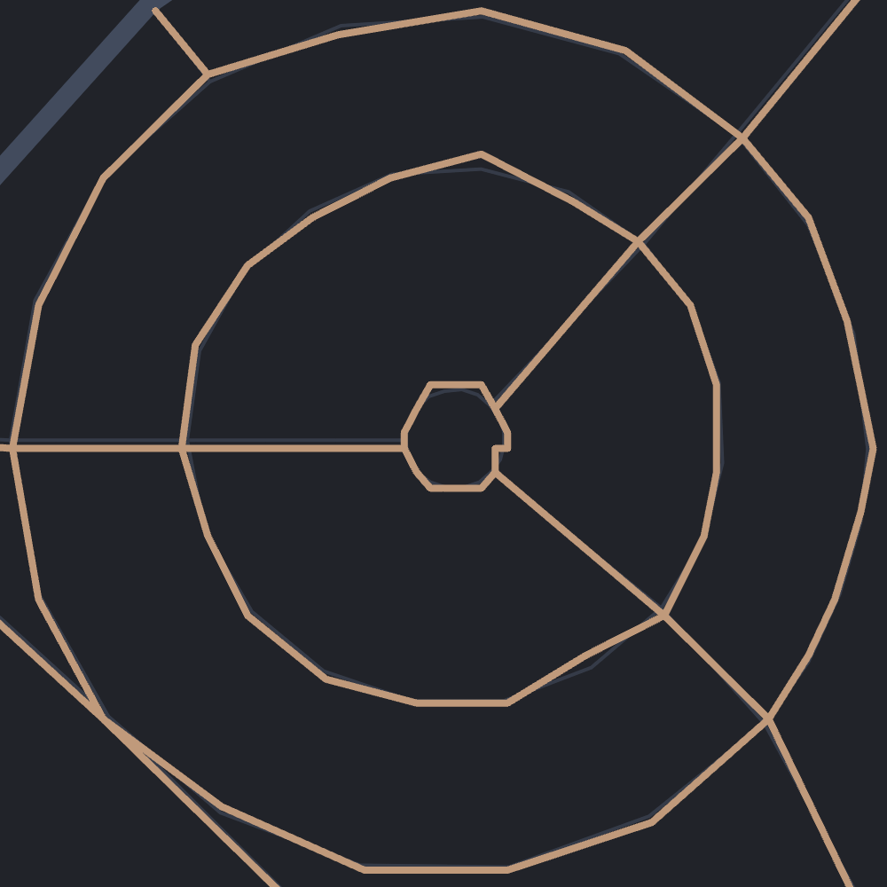
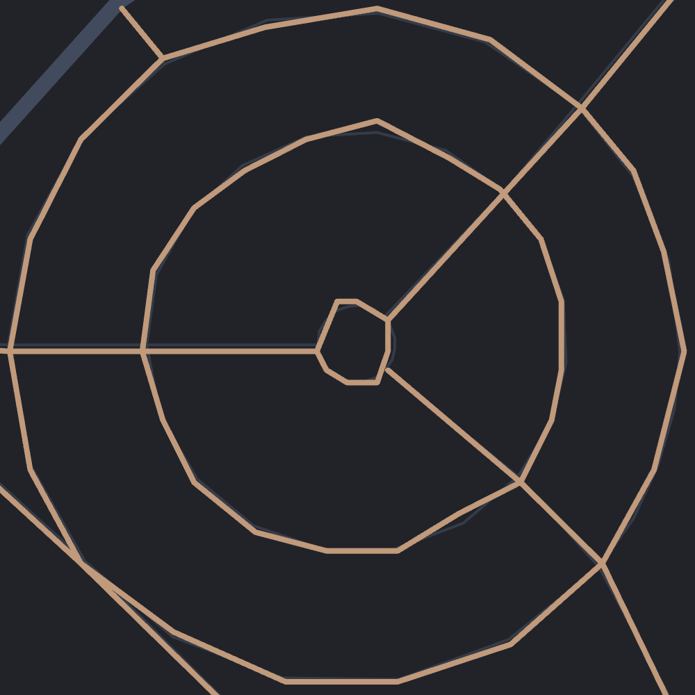
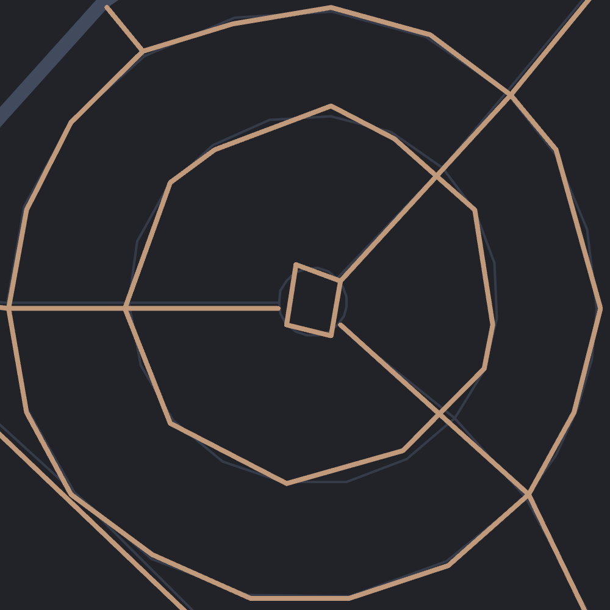
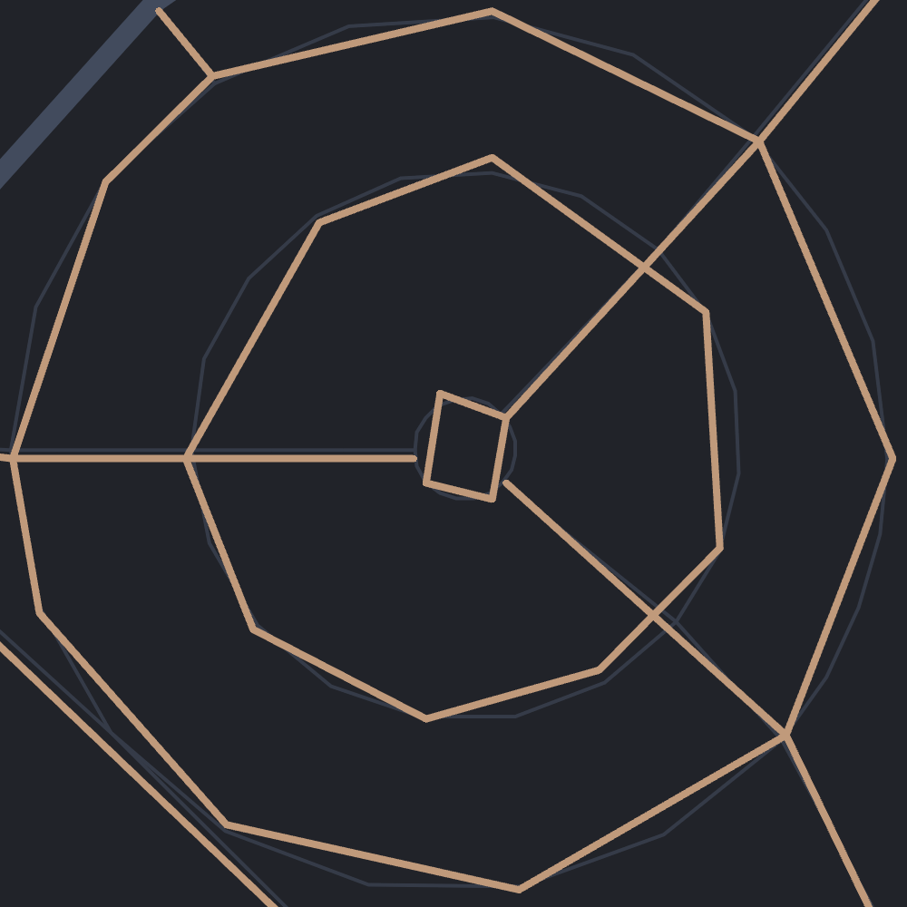

```
[out:json][timeout:3600];
area["ISO3166-1"="DE"][admin_level=2];
way["highway"]["surface"~"^(gravel|fine_gravel|compacted|pebblestone)$"](area);
out skel geom qt;
```
Return all gravel roads [^gravel] in Germany and their geometry. This innocent looking [Overpass API](https://wiki.openstreetmap.org/wiki/Overpass_API) query forced Node.js onto its knees. _Cannot create a string longer than `0x1fffffe8` characters_, it whispered with its dying breath. Its internal string length capped at 536 MB. But this response was 614 MB.

[^gravel]: I hereby use the power granted to me by myself to define what is gravel and what is not. Something the gravel community still struggles with.

## Simplify
<!-- https://poi.smolka.dev/#19.98/51.2961833/12.3971305 -->
- 
- 
{.fluent}

- 
- 
{.fluent}

```js
[
  [6.6714466, 49.2574289],  // [longitude, latitude]
  [6.6714863, 49.257563],
  [6.6714959, 49.2580319],
  [6.6714861, 49.2582483],
  [6.6715423, 49.2582771]
]
```

## Precision
```js
const PRECISION = 5;
const SCALE = 10 ** PRECISION;

function precision(polyline) {
  return polyline.map((coordinates) =>
    coordinates.map((coordinate) => Math.round(coordinate * SCALE)),
  );
}
```

```js
[
  [667145, 4925743],
  [667149, 4925756],
  [667150, 4925803],
  [667149, 4925825],
  [667154, 4925828]
]
```

## Offset
```js
const previous = [0, 0];

function offset(polyline) {
  return polyline.map((coordinates) =>
    coordinates.map((coordinate, index) => {
      const offset = coordinate - previous[index];
      previous[index] = coordinate;
      return offset;
    }),
  );
}
```

```js
[
  [-15, -88],
  [4, 13],
  [1, 47],
  [-1, 22],
  [5, 3]
]
```

Ordering the output by quad tile `out qt;` improved compression.

## Zigzag
```js
function zigzag(polyline) {
  return polyline.map((coordinates) =>
    coordinates.map((coordinate) => (
      coordinate >= 0 ? coordinate * 2 : -coordinate * 2 - 1
    )),
  );
}
```

```js
[
  [29, 175],
  [8, 26],
  [2, 94],
  [1, 44],
  [10, 6]
]
```

## Encode
```js
function writeVarint(out, value) {
  while (value > 0x7f) {
    out.push((value & 0x7f) | 0x80);
    value >>>= 7;
  }
  out.push(value);
}
```

```js
[
  0x1d, 0xaf, 0x01,  // 175 = (0xaf & ~0x80) + ((0x01 & ~0x80) << 7)
  0x08, 0x1a,
  0x02, 0x5e,
  0x01, 0x2c,
  0x0a, 0x06
]
```

## Conclusion
| Step      | Description                                | Size [KB] |
| --------- | ------------------------------------------ | --------: |
| Raw       | Raw data returned by the Overpass query    |   614,312 |
| Geometry  | Remove all but geometric data              |   239,784 |
| Simplify  | Simplify polylines with a tolerance of 0.5 |   196,512 |
| Precision | Round coordinates to 5 decimal places      |   148,189 |
| Offset    | Store offset to previous coordinates       |    73,864 |
| Zigzag    | Convert negative to positive numbers       |    70,296 |
| Encode    | Encode in a binary format using varints    |    20,783 |
| Compress  | Compress with deflate                      |    17,994 |
{.tabular-nums}

Similar compression applied to all data. Vercel static file limit is 100 MB.

<details>
  <summary>:)</summary>
  :(
</details>

| Country     | Cafes | Cemeteries | Cobbles |  Gas | Gravel | Grocers | Water |
| ----------- | ----: | ---------: | ------: | ---: | -----: | ------: | ----: |
| Austria     |   126 |         29 |      78 |   26 |  2,880 |      80 |    35 |
| Belgium     |   111 |         39 |     218 |   23 |    653 |      80 |     6 |
| Czechia     |    91 |         34 |     232 |   34 |    887 |      98 |     9 |
| Denmark     |    80 |         17 |      48 |   15 |  1,586 |      41 |     5 |
| France      |   699 |        277 |     337 |   96 |  5,142 |     461 |   106 |
| Germany     | 1,103 |        277 |   2,018 |  181 | 17,886 |     586 |    46 |
| Italy       |   629 |        152 |     807 |  139 |  5,208 |     268 |   267 |
| Netherlands |   146 |         32 |      43 |   39 |    873 |      87 |    12 |
| Poland      |   198 |        118 |     377 |   65 |  2,249 |     373 |    10 |
| Portugal    |   182 |         40 |     645 |   23 |    471 |      68 |    28 |
| Spain       |   394 |        139 |     289 |  118 |  3,153 |     247 |   185 |
| Switzerland |   100 |         19 |     103 |   30 |  2,123 |      89 |    59 |
{.tabular-nums}

But with great datasets come great performance problems.

- 
{.cover}

> But from a global allocation perspective, actually, it’s quite terrible to have everybody have a bunch of the world’s limited supply of DRAM sitting in their own computer. And, being used 5% of the time. You want maximum utilization in the cloud if you’re trying to deal with this very supply constrained environment.
>
> <cite>Sam Altman</cite>
