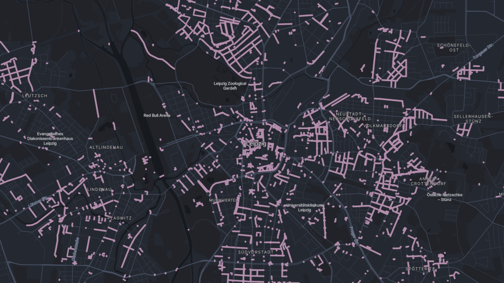

Paris--Roubaix, also known as the [_Hell of the North_](https://hellofthenorth.info/), is one of cycling's five [monuments](https://en.wikipedia.org/wiki/Cycling_monument) and one of the most spectacular races of the season. Ask any professional which race they dream of winning at least once during their career, and Paris--Roubaix will be on top of that list.

This year's [edition](https://www.paris-roubaix.fr/en/news/2026/54-8-km-of-cobblestones-the-ratings-game/4775) featured 30 cobbled sectors with a combined length of 54.8 km. Each sector receives a [rating](https://www.paris-roubaix.fr/en/news/2023/paris-roubaix-sector-ratings/3925) between one and five stars based on its length, unevenness, overall condition of the cobbles and location within the race. The mythical sectors deserving of a five-star rating are [Trouée d'Arenberg](https://en.wikipedia.org/wiki/Trou%C3%A9e_d%27Arenberg), Mons-en-Pévèle and Carrefour de l'Arbre.

- ")
{.overflow}

Unfortunately, those sectors not only attract fans. Arenberg forest had to deal with [thieves](https://road.cc/news/paris-roubaix-cobbles-stolen-from-arenberg-forest) taking pavé-shaped souvenirs back home for years, a privilege usually reserved for the winner of the race. In contrast, there are the [Les Amis de Paris--Roubaix](https://lesamisdeparis-roubaix.com/), the _Friends of Paris--Roubaix_, a group of enthusiasts dedicated to the preservation, restoration and maintenance of the iconic cobbled sectors.

## poi

I like to explore the unknown roads around Leipzig, which can be adventurous at times. You tend to get a bit of everything: new, smooth tarmac, patched roads, gravel and sometimes even short cobblestone sections. I enjoy the ones I'd classify between one and three stars but recently hit a two-kilometer stretch of something well above that and swore to myself: **never again**, time to extended [poi](https://poi.smolka.dev/).

```
way
  ["highway"]
  ["surface"~"^(cobblestone|sett|cobblestone:flattened|unhewn_cobblestone)$"]
  (area);
```

The [Overpass](https://wiki.openstreetmap.org/wiki/Overpass_API) query above returns all roads with a [cobblestone surface](https://wiki.openstreetmap.org/wiki/Tag:surface%3Dcobblestone). The response contains over 100 MB of data, which is unfeasible to download every time the web app is opened. I stripped the metadata and used Google's [polyline encoding](https://developers.google.com/maps/documentation/utilities/polylinealgorithm) for the paths. The result is a much leaner 6 MB file. poi then converts the raw data into GeoJSON and displays the roads in a nice purple color.

Here is what it looks like for Leipzig [^germany]. Clicking on a road opens a popup with a link to Google Maps. There you can use Street View to rate the sector yourself and decide whether it is pain or pleasure.

[^germany]: If you zoom out far enough to cover [Germany](img/germany.png), you can see something I, and probably others, like to call "every map of Germany ever", which is a clear distinction between post-war East and West Germany. The East usually takes the short end of the stick in the visualized statistic.

- 
{.overflow}
